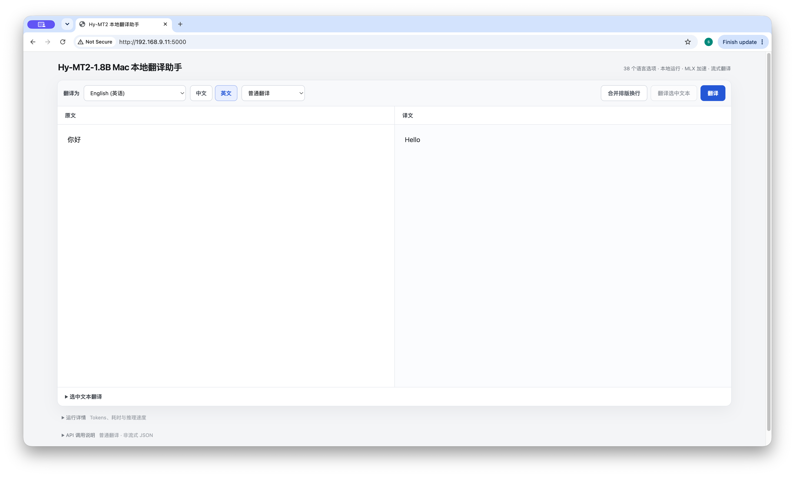

# HY-MLX-Translator - Hy-MT2-1.8B Local Translation Assistant for Mac

> A local translation website for Apple Silicon Macs, powered by Tencent Hunyuan Hy-MT2-1.8B and MLX. It streams translation results for a responsive translation experience.
> ⚠️ 99% of this project's code is implemented by vibe coding! There may be some bugs or imperfections. Please use with caution.

<p align="center">
  
</p>

Since Google Translate often doesn't work properly due to network issues, I decided to create a local translation assistant. Since I use a Mac computer, I adopted the [MLX-LM framework](https://github.com/MLX-LM/MLX-LM) as the inference engine to accelerate LLM running speed on Mac.

The project uses [Tencent Hunyuan Hy-MT2-1.8B](https://huggingface.co/tencent/Hy-MT2-1.8B), a multilingual translation model optimized for complex real-world scenarios and translation instruction following. Inference follows the model's official prompt format and recommended sampling parameters.

|  |
|:--:|
|  |
| *Translation Assistant Interface (Since it's a productivity tool, the interface is kept as simple as possible)* |

## Recent Updates

- 🧭 Added guided modes based on the official task examples: terminology uses a pair table, while the other modes show only the style, preference, format, or background fields they need. The old “Add Reference” workflow has been removed.
- 🔌 Simplified the public API to a non-streaming JSON endpoint for default translation; the web UI keeps its internal SSE streaming experience.
- 🚀 Upgraded the inference model to Hy-MT2-1.8B with its official prompts, chat template, and recommended sampling parameters
- ✨ Added a "Join Wrapped Lines" button that repairs OCR/PDF line wrapping, including hyphenated words, missing spaces, and punctuation boundaries

## Project Features

- 🍎 **Mac-friendly**: Runs completely locally and is fast on Apple M-series chips
- 🌍 **Multi-language support**: Provides all 38 language options listed in the Hy-MT2 README
- ⚡ **Streaming output**: Displays translation results in real-time without waiting for complete generation
- 🧭 **Multiple translation modes**: Terminology, style, personalization, delimiter, structured-data, and background-aware translation
- 📊 **Performance statistics**: Real-time display of Tokens count, total time, TTFT, TPOT and other performance indicators

## Technology Stack

- **Backend**: Flask + Flask-CORS
- **Framework**: MLX-LM (Apple Silicon optimized)
- **Model**: Hy-MT2-1.8B (Tencent Hunyuan)
- **Frontend**: Native HTML + CSS + JavaScript

## Local Running Steps

### 1. Install Dependencies

```bash
pip install flask flask-cors mlx-lm
```

### 2. Download Model

```bash
bash download_model.sh
```

The script downloads `tencent/Hy-MT2-1.8B` from Hugging Face when available, falls back to ModelScope, and saves it to `Hy-MT2-1.8B/`.

### 3. Start Service

```bash
python app.py
```

After the service starts, access `http://127.0.0.1:5000` in your browser to use it.

### 3.1 Customize host and port

To specify host or port, you can use command-line parameters:

```bash
python app.py --host 0.0.0.0 --port 8080
```

Parameter description:
- `--host`: Specify listening address (default: `127.0.0.1`)
- `--port`: Specify port number (default: `5000`)
- `--debug`: Enable Flask debug mode (disabled by default)

## Exposing Service Externally

By default, the service only listens to the local address (`127.0.0.1`) and can only be accessed on the local machine. To expose the service externally, use the `--host 0.0.0.0` parameter:

```bash
python app.py --host 0.0.0.0 --port 5000
```

After modification, devices within the same local area network can access it through `http://<your Mac's IP>:5000`.

### ⚠️ Security Reminder

- Debug mode is intended for development only; do not pass `--debug` in production
- Please pay attention to network security when exposing services externally, it is recommended to use in a trusted network environment
- If you need to access it on the public network, it is recommended to use Nginx reverse proxy and configure HTTPS

## Web Translation Modes

The web UI uses default translation unless another mode is selected. Each advanced mode shows its own guidance and required inputs:

- **Terminology**: Add one or more source-term / preferred-translation pairs.
- **Style**: Describe the required tone, writing style, or use case.
- **Personalization**: Enter one translation preference per line.
- **Delimiters**: Keep protected delimiters in the source text; no extra field is needed.
- **Structured data**: Enter the actual format, such as JSON, XML, or YAML.
- **Background information**: Provide context that helps disambiguate the source text.

The prompts follow the official task examples in `Hy-MT2-1.8B/README.md`.

## API Interface

For developer use, the project exposes only a simple non-streaming default-translation interface. It waits for the complete translation and returns JSON. `target_language` must be a full English language name from the model README, such as `Chinese`, `English`, or `Japanese`.

```http
POST /api/translate/sync
Content-Type: application/json

{
  "text": "Hello, world.",
  "target_language": "Chinese"
}
```

Response example:

```json
{
  "model": "Hy-MT2-1.8B",
  "target_language": "Chinese",
  "translation": "你好，世界。",
  "stats": {
    "token_count": 5,
    "prompt_tokens": 28,
    "total_time": 1.2345
  }
}
```

The web UI still uses SSE internally for streaming display and cancellation, but that internal protocol is not part of the public developer API.

## Acknowledgments

- Model: Tencent Hunyuan [Hy-MT2-1.8B](https://huggingface.co/tencent/Hy-MT2-1.8B)
- Inference framework: [MLX-LM](https://github.com/ml-explore/mlx-lm)
- Code: [Doubao](https://www.doubao.com/chat/)

## License

See `Hy-MT2-1.8B/LICENSE.txt`.
